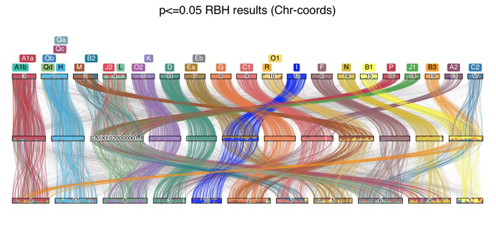
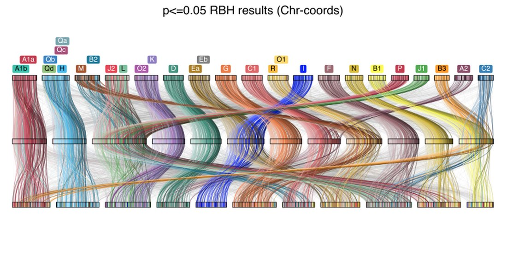

# Ribbon plot options (`odp_rbh_to_ribbon`)

This page lists the ribbon-plot options added in November 2026, from the Schultz Lab ribbon standard. Every option is off by default: a config without them draws the same figure as before, pixel for pixel. The options go in the same `config.yaml` as the rest of the `odp_rbh_to_ribbon` settings (see `example_configs/CONFIG_rbh_to_ribbon.yaml`).



*Pecten maximus*, *Owenia fusiformis* and *Streblospio benedicti* drawn with the lab-standard settings below. The chromosome bars are painted with the fractions of their linkage groups, names sit on the bars where they fit, and labels sit above the top species.

## The lab standard in one block

```yaml
figure_width_in: 7.087          # 180 mm, a double-column figure
show_gene_coords: False         # the chromosome-coordinate panel only
font:
  sans_serif: Helvetica
  size: 7
ribbon_lw: 0.5                  # pt
ribbon_alpha_sig: 0.4           # ribbons on significant blocks (break_FET <= 0.05)
ribbon_alpha_faint: 0.05        # all other ribbons
unassigned_color: "#8c8c8c"     # orthologs in no linkage group: gray ...
unassigned_alpha: 0.05          # ... and faint
ribbon_shuffle: True            # no linkage-group color sits on top of the others
chrom_paint: True               # bars painted with their linkage-group fractions
chrom_capstyle: round
chrom_names_on_bars: True
alg_labels: True                # label boxes above the top species
show_legend: False
show_chrom_labels: False        # names are on the bars instead
min_scaf_fraction: 0.2          # leave out unplaced scaffolds
```

## Options

| Key | Default | What it does |
|---|---|---|
| `ribbon_lw` | 0.25 | Ribbon width in pt. `ribbon_lw_sig` and `ribbon_lw_faint` set the two kinds separately. |
| `ribbon_alpha_sig`, `ribbon_alpha_faint` | 0.8, 0.1 | Opacity of ribbons on blocks odp finds significant (`break_FET` <= 0.05) and of all others. |
| `unassigned_color`, `unassigned_alpha` | `#000000`, as other ribbons | Color and opacity of orthologs in no linkage group (odp writes them black). |
| `ribbon_shuffle` | False | Draw the ribbons in a shuffled order (fixed seed), so no linkage-group color sits on top. |
| `chrom_lw` | matplotlib default | Width of the plain chromosome bars, in pt. |
| `min_scaf_fraction` | 0 | Leave out scaffolds shorter than this fraction of the median length of the species' scaffolds with at least 10 orthologs (unplaced scaffolds). Works with `minscafsize`. |
| `chrom_paint` | False | Paint each bar with the fractions of its linkage groups along its length. Bins are 1/1000 of the species' plotted length, and each bin counts itself and two bins on either side: the method of the ALG composition tracks in Schultz et al. 2026 (Science Advances), Fig. 8. `chrom_paint_height` (0.08 rows) sets the bar height. |
| `chrom_paint_tracks` | False | Add the Count (symmetric) and Fraction tracks under the last species. |
| `chrom_paint_other` | none | `orthologs` adds orthologs in no linkage group, in gray; `genes` adds every gene of the species' `.chrom` file (`species: SP: chrom:`), in gray. This shows how much of each window the linkage groups account for. |
| `chrom_names_on_bars` | False | Chromosome names centered on the bars, only where they fit (`chrom_name_fontsize`, 6). A shared prefix without digits (PMA, chr, Ch_) and a shared version suffix (.1) are dropped only when every name then has four characters or fewer, so accession numbers stay whole. `chrom_name_map: {SP: {scaffold: name}}` sets names. |
| `show_chrom_labels` | True | The original chromosome names above the bars. |
| `alg_labels` | False | Linkage-group label boxes above the top species, each over the chromosome that holds most of its orthologs. Boxes move only along their own chromosome and stack in as many tiers as needed. The text is white or black by APCA contrast; `alg_label_text_colors: {group: color}` overrides it. `alg_label_fontsize` is 7. |
| `show_legend` | True | The legend panel under the plot. |
| `order_ref` | none | Shade ribbons and paint bars light to dark by each gene's position along this species' chromosomes, within its linkage group. Shades are carried to the other species through the ortholog pairs. A smooth run of shades means the gene order survives; mixed shades mean it does not. |
| `focus_groups` | [] | Draw these linkage groups in color and every other ribbon gray. |
| `follow`, `follow_label` | none | Draw a gene set black on top: a list (or a file) of `SP:gene` or `SP:scaffold:start-end`. |
| `microsynteny` | False | Draw on top the orthologs in runs of at least `microsynteny_min_run` (3) neighbors that stay within `microsynteny_window` (3) ortholog ranks on one chromosome of the next species. `microsynteny_color` is `dark` (the group color darkened), `gray` or a color. |
| `riparian_min` | 0 | Riparian bands, only for collinear runs: at least this many orthologs that are neighbors in both genomes, in the same or reversed order, with nothing crossing inside. A reversed run (an inversion) twists. Everything else stays ribbons. |
| `rasterize_ribbons` | False | Ribbons and bands as one image inside the PDF; bars, labels and text stay vector. The file grows. |



`order_ref: OFU`: the *Owenia* bars run light to dark by construction, while the *Pecten* and *Streblospio* bars show mixed shades. Their genes stayed in the same linkage groups but changed order.

## Extra outputs

Each one is a separate file written next to `output.pdf`. If one fails (for example, `animate` without ffmpeg), odp prints a warning and the main plot is still written.

| Key | What it writes |
|---|---|
| `zoom: "SPA:chrom,SPB:chrom"` | `zoom_pdf` (zoom.pdf): that pair of neighboring chromosomes on one Mb scale, one ribbon per ortholog. |
| `small_multiples: N` | `small_multiples_pdf` (small_multiples.pdf): one panel per linkage group in N columns, with only that group's ribbons. |
| `animate: talk.mp4` | A movie for talks (1920 by 1080, needs ffmpeg) and a GIF beside it. The orthologs found in every species travel as dots from one genome's chromosomes to the next. `animation_background` is `light` or `dark`. |
| `interactive_html: ribbons.html` | The plot as a self-contained web page. Point at a ribbon for its genes and positions; click a label or a chromosome to spotlight it. |

`species_names: {SP: "Genus species"}` names the species in the extra outputs.
